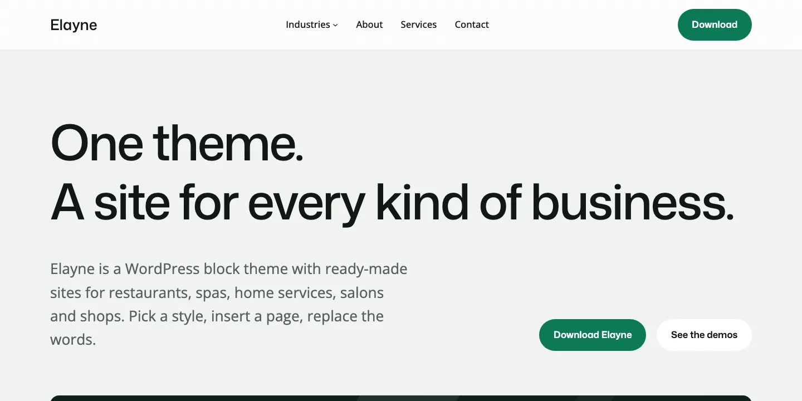
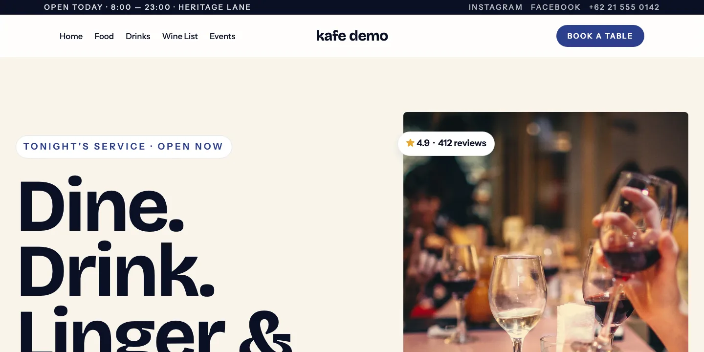
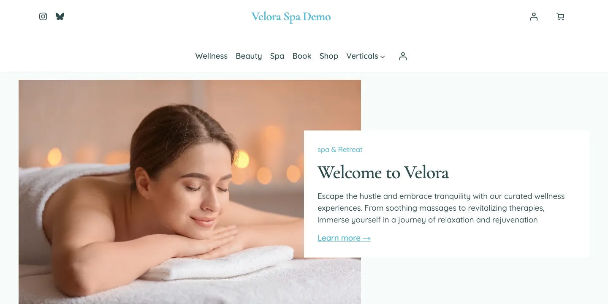
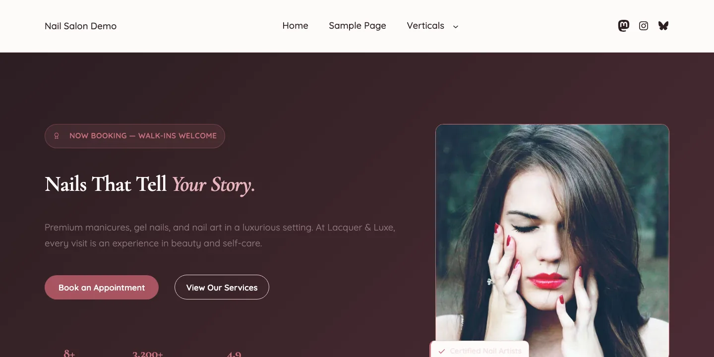
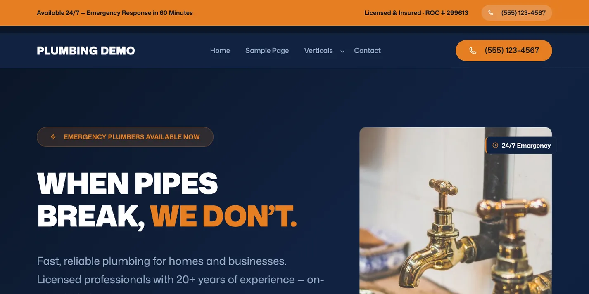
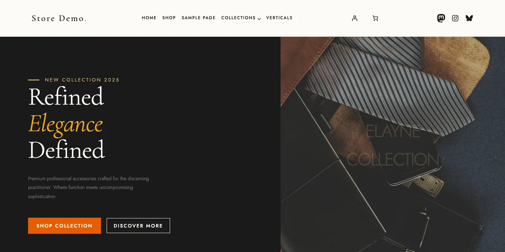
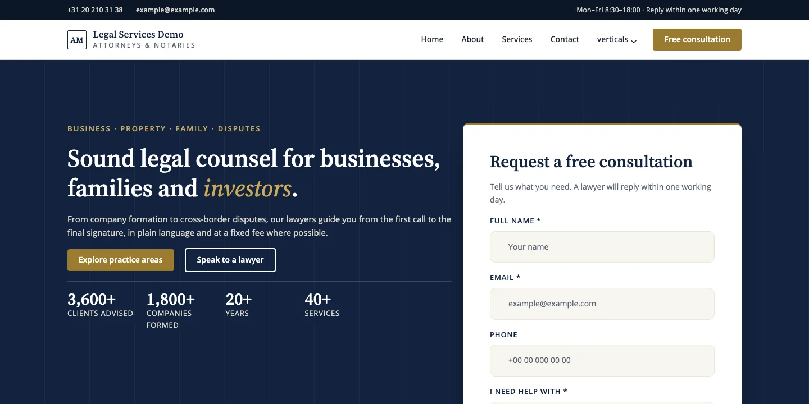
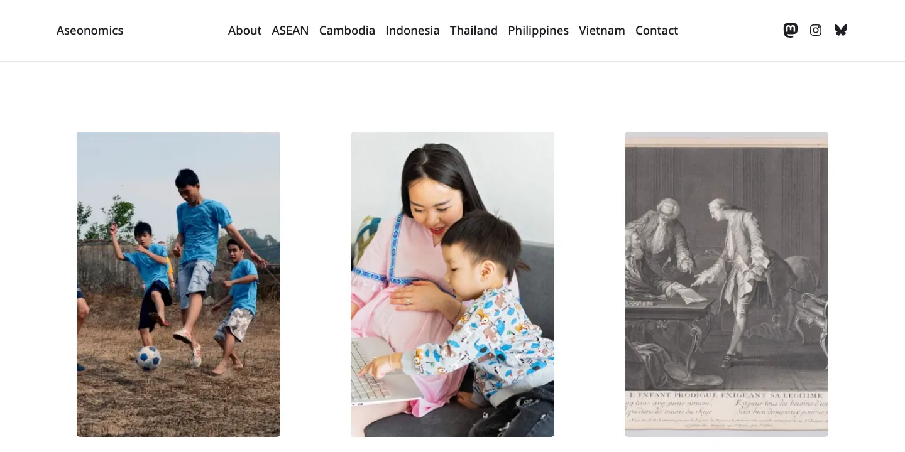

<p align="center">
  
</p>
<div align="center">
<h1>Elayne</h1>
</div>
<div align="center">

[](https://wordpress.org/themes/elayne/)
[](https://wordpress.org/themes/elayne/)
[](https://wordpress.org/themes/elayne/)
[](https://packagist.org/packages/imagewize/elayne)
[](https://github.com/imagewize/elayne/actions/workflows/theme-check.yml)

</div>

Design better, build faster, publish sooner. Elayne is a professional WordPress block theme designed for modern businesses, offering sophisticated patterns and conversion-optimized layouts — no coding or expensive page builders required.

## One Theme, a Site for Every Kind of Business

Every screenshot below is a live Elayne site. Pick the one closest to your business, open the editor, replace the words.

<table>
<tr>
<td align="center"><a href="https://demo.imagewize.com/"></a><br><sub><b>Main</b> · Bold variation</sub></td>
<td align="center"><a href="https://demo.imagewize.com/kafe/"></a><br><sub><b>Restaurant</b> · Bistro variation</sub></td>
<td align="center"><a href="https://demo.imagewize.com/spa/"></a><br><sub><b>Spa</b> · Spa & Wellness variation</sub></td>
</tr>
<tr>
<td align="center"><a href="https://demo.imagewize.com/nail-salon/"></a><br><sub><b>Nail Salon</b> · Nail Salon variation</sub></td>
<td align="center"><a href="https://demo.imagewize.com/plumbing/"></a><br><sub><b>Home Services</b> · Home Improvement variation</sub></td>
<td align="center"><a href="https://demo.imagewize.com/store/"></a><br><sub><b>Shop</b> · WooCommerce + Store variation</sub></td>
</tr>
<tr>
<td align="center"><a href="https://demo.imagewize.com/legal/"></a><br><sub><b>Law Firm</b> · Elayne Legal child theme</sub></td>
<td align="center"><a href="https://aseonomics.com/"></a><br><sub><b>Publication</b> · Publicist variation · aseonomics.com</sub></td>
</tr>
</table>

> **Lineage:** Elayne is the flagship of Imagewize's block theme family, alongside the minimal starter theme [Aviendha](https://github.com/imagewize/aviendha) and [Nynaeve](https://github.com/imagewize/nynaeve), with [Ixian](https://github.com/imagewize/ixian) built on top of Aviendha. Elayne ships no custom blocks of its own and requires none — every pattern is built from core blocks, with WooCommerce and Contact Form 7 blocks where a pattern is store- or form-specific. The shared [Aludra](https://github.com/imagewize/aludra) block library pairs with it optionally; Aviendha and Ixian build on Aludra directly, while Nynaeve registers its own blocks instead.

## Why Choose Elayne?

- **Ready-Made Sites for Real Businesses**: Complete pattern sets for restaurants and cafés, spa and wellness, home services, salons and shops — real section designs, not lorem ipsum shells
- **One-Click Style Variations**: 8 full design systems — colors, fonts, buttons and all — swap your entire site's look in one click
- **140+ Patterns, All Core Blocks**: Every pattern is native WordPress blocks — no page builder, no lock-in, nothing to break on the next WordPress update. The 32 interactive block styles (hovers, reveals, marquees) are pure CSS with zero JavaScript
- **Conversion-Optimized Sections**: Heroes, CTAs, pricing, testimonials and stats designed to turn visits into enquiries
- **Quality You Can Check**: the color contract — every pattern color resolves under every style variation — runs in CI, and each variation ships a WCAG contrast report (`composer check:colors`)
- **True No-Code Solution**: Seamlessly integrated with WordPress's native site editor — drag, drop, and publish

Built by [Jasper Frumau](https://imagewize.com), Elayne empowers businesses to create stunning professional websites using the latest Full Site Editing features.

## Quick Start

| Action | Link |
| --- | --- |
| **View Demo** | [demo.imagewize.com](https://demo.imagewize.com) |
| **Documentation** | [imagewize.com/themes/elayne](https://imagewize.com/themes/elayne) |
| **Support** | [imagewize.com/support](https://imagewize.com/support) |

### Requirements
- WordPress 7.0 or later
- PHP 8.0 or later
- WooCommerce (optional, for store templates and patterns)
- Aludra plugin (optional, adds Mega Menu, Carousel, FAQ Tabs, and other blocks — nothing Elayne ships depends on it)

## Installation

Elayne is in the [WordPress.org theme directory](https://wordpress.org/themes/elayne/):

1. In your dashboard, go to **Appearance → Themes → Add New Theme** and search for "Elayne"
2. Click **Install**, then **Activate**
3. Start designing in **Appearance → Editor**

To install manually instead, download the zip from [WordPress.org](https://wordpress.org/themes/elayne/) or [GitHub releases](https://github.com/imagewize/elayne/releases) and upload it via **Appearance → Themes → Add New Theme → Upload Theme**.

For developer installation and setup, see [CONTRIBUTING.md](CONTRIBUTING.md)

## What's Included

**140+ patterns** (24 of them built for WooCommerce) across hero sections, features, CTAs, testimonials, cards, blog, portfolio, and more. Includes 19 page, post, and WooCommerce templates.

**Page Layouts** — full-page compositions that assemble multiple section patterns into a single ready-to-insert page, so you go from blank canvas to a finished page in one paste: Agency About, Generic Contact, Main Site Homepage, and Agency Services, plus Store-specific Homepage, Shop, Cart, and Checkout compositions.

**Industry verticals** with complete, ready-to-use pattern sets: Food & Beverage • Legal Services • Home Improvement • Spa & Wellness • Nail Salon • WooCommerce Store

**Vertical child themes:** Elayne is large, so new industry verticals now ship as separate child themes that require Elayne as the parent. Elayne itself keeps working exactly as before and stays on WordPress.org; no new vertical pattern sets will be added here. The legal patterns bundled in this theme stay for now and will be deprecated in a later release. See [Vertical Child Themes](#vertical-child-themes).

**8 style variations** — switch your entire site's look with one click in **Appearance → Editor → Styles**

**32+ CSS block styles** — interactive animations and effects with zero JavaScript, applied via the Styles panel in the block editor

Browse the complete pattern library in **Appearance → Editor → Patterns**. See [CONTRIBUTING.md](CONTRIBUTING.md) for the full pattern inventory and developer documentation.

## Vertical Child Themes

A child theme adds one vertical's design on top of Elayne: its own patterns, style variations, header and footer. Elayne stays the parent and supplies the base theme, the shared patterns and the WooCommerce templates.

| Child theme | Vertical | Status | Install |
| --- | --- | --- | --- |
| [Elayne Legal](https://github.com/imagewize/elayne-legal) | Law firms | v1.0.0, public | `composer require imagewize/elayne-legal` or the zip from GitHub releases |

Child themes are not listed on WordPress.org. Install Elayne first, then the child, and activate the child under **Appearance → Themes**. Pattern slugs stay `elayne/<vertical>-*`, so a child's patterns replace the ones still bundled here. Developers: see [CONTRIBUTING.md](CONTRIBUTING.md) and `CLAUDE.md` for the child anatomy and validation workflow.

## Getting Started

Access the WordPress Site Editor at **Appearance → Editor** to customize your site. Insert patterns, edit templates, and adjust global styles — all with drag-and-drop simplicity. Visit the [documentation](https://imagewize.com/themes/elayne) for detailed tutorials.

## Companion Plugins

### Aludra

Elayne works seamlessly with the **[Aludra](https://github.com/imagewize/aludra)** plugin, which provides 30 custom blocks including Mega Menu, Carousel, Slide, FAQ Tabs, Hero Banner, Pricing Tiers, Testimonial Grid, and more. Aludra is a theme-agnostic shared block library that works with any WordPress theme. It is the direct continuation of the Elayne Blocks plugin, now serving multiple Imagewize themes.

It is genuinely optional: as of 4.9.2 nothing Elayne ships references an `aludra/*` block or pattern, so every theme pattern and template part renders correctly without it. Aludra adds blocks to build *with*; it is not a dependency.

Download from the [Aludra repository](https://github.com/imagewize/aludra) and install via **Plugins → Add New → Upload Plugin**.

### Waygate AI Builder

[Waygate](https://github.com/imagewize/waygate) is an AI-powered pattern page builder for Elayne. Describe a page or section in plain language and Waygate assembles it from Elayne's pattern library.

**Install from GitHub:** Download from [github.com/imagewize/waygate/releases](https://github.com/imagewize/waygate/releases) and upload via **Plugins → Add New → Upload Plugin**.

**Install via Composer** (Bedrock / developer setup):

```bash
composer require imagewize/waygate
```

## Community & Support

- **Support**: [imagewize.com/support](https://imagewize.com/support)
- **Documentation**: [imagewize.com/themes/elayne](https://imagewize.com/themes/elayne)
- **Website**: [imagewize.com](https://imagewize.com)
- **Contributing**: See [CONTRIBUTING.md](CONTRIBUTING.md) for developer documentation

## About

Elayne is created and maintained by [Jasper Frumau](https://imagewize.com).

### Credits

- **Theme Author**: Jasper Frumau
- **Fonts & Images**: All fonts and images are GPL-compatible. See [readme.txt](readme.txt) for complete license details and attribution.
- **Base Architecture**: Inspired by modern WordPress block theme standards

**[View Demo](https://demo.imagewize.com)** | **[Visit Imagewize](https://imagewize.com)**

## License

GNU General Public License v3.0 (or later). See [LICENSE.md](LICENSE.md).
